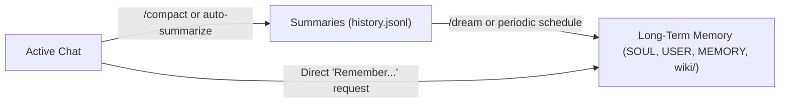

# AI Agent Memory in nanobot

nanobot keeps recent chat history separate from long-term memory like your preferences, background, and ongoing project knowledge. You can inspect, edit, and restore long-term memory at any time.

> [!NOTE]
> An agent replying "Got it, I'll remember that" does not automatically guarantee a preference was written to long-term memory. You can verify or update it directly using the steps below.

## How Memory Works



nanobot organizes memory into four layers so conversations stay fast while useful knowledge builds up over time:

| Layer | Where it lives | What it holds |
|---|---|---|
| Active conversation | Session history | Recent messages in the current topic or chat |
| Conversation summaries | `memory/history.jsonl` | Compact summaries of older turns created when a chat grows long or when you run `/compact` |
| Resident memory | `SOUL.md`, `USER.md`, `memory/MEMORY.md` | Core personality, user preferences, and key facts loaded into every conversation |
| Knowledge wiki | `memory/wiki/` | Detailed Markdown notes read on demand when relevant to a task |

Long-term memory updates in two ways:

1. **Direct updates:** When you ask nanobot to remember something (or share a lasting preference) in a chat with write access, it can update the relevant memory file right away.
2. **Compaction + Dream:** As conversations grow long (or after idle time, or when you run `/compact`), nanobot summarizes older messages and saves the summary to `memory/history.jsonl`. Periodically (or when you run `/dream`), **Dream** reviews new summaries and makes focused edits to your resident memory files and `memory/wiki/`.

Every Dream update is versioned with Git in your agent workspace, so you can inspect what changed and roll back if needed.

## Where Memory Files Live

All memory files belong to your **agent workspace** (`~/.nanobot/workspace/` by default):

```text
workspace/
├── SOUL.md              # Agent voice and communication style
├── USER.md              # Stable preferences and facts about you
├── prompts/
│   └── dream.md         # Optional custom instructions for Dream
└── memory/
    ├── MEMORY.md        # Core facts and links to wiki pages
    ├── wiki/            # Optional detailed Markdown notes
    │   └── index.md     # Topic index read on demand
    ├── imports/         # Uploaded source files waiting for or archived after Dream
    └── history.jsonl    # Recent conversation summaries
```

Picking a different **project workspace** in the WebUI changes where the agent works on files, not where its memory lives. That means one agent keeps continuous memory across projects and topics.

> [!IMPORTANT]
> Starting a new topic or choosing a different project does **not** isolate long-term memory. If you need separate memory for different clients or users, run [Multiple Instances](./multiple-instances.md).

## Save and Check a Preference

In any WebUI or terminal chat, state a clear preference:

```text
Remember that for Acme release notes I prefer concise bullet points and British spelling.
```

- If the chat has write access to your agent workspace, nanobot can save it right away. Ask which file it updated, then verify in a new topic.
- If you are in a **Restricted** chat inside a different project folder, nanobot can read `memory/wiki/` but cannot write to your agent memory files. Switch to the agent workspace, edit the file yourself, or run `/compact` followed by `/dream` to consolidate recent chats.

## Memory Commands

Use these slash commands in chat to inspect, run, or restore memory:

| Command | What it does |
|---|---|
| `/compact` | Summarize the current conversation now (full chat history remains visible) |
| `/dream` | Run Dream consolidation now |
| `/dream-log` | Show the latest Dream memory change |
| `/dream-log <sha>` | Show a specific Dream memory change |
| `/dream-restore` | List recent Dream memory versions |
| `/dream-restore <sha>` | Restore memory files and wiki pages to the state before that change |
| `/dream-prompt` | Show the current instructions guiding Dream |
| `/dream-prompt init` | Create an editable `prompts/dream.md` guide for this workspace |

> [!NOTE]
> `/dream-restore <sha>` restores all managed memory files and wiki pages together (not a single page). If you have uncommitted manual edits in memory files, commit or revert them before restoring.

## Browse and Import Memory

Open **记忆** in the WebUI sidebar to inspect the agent's resident memory and Wiki, or to import Markdown source documents. This page always uses the current agent workspace, regardless of the project selected in a chat.

The memory library is read-only. It lists `SOUL.md`, `USER.md`, `memory/MEMORY.md`, and Markdown files under `memory/wiki/`; relative links between Wiki pages can be opened in the page. Imported originals, chat history, skills, and unrelated workspace files are not part of the memory library.

You can upload a UTF-8 Markdown file up to 256 KiB. The original bytes are kept under `memory/imports/`, separate from the Wiki and Git history. Uploading does not immediately change memory: the next Dream run reviews pending files with the same model preset and memory rules as chat summaries. Scheduled Dream waits until active chat work has finished; `/dream` starts a manual run immediately.

An import first appears as **待整理**. After Dream reviews the complete file, it becomes **已归档**, including when the file needs no memory changes. If processing fails or cannot be confirmed, the original remains available with a short error and is retried by a later Dream run. Deleting archived imports removes only the managed original files; it does not undo memory written from them.

## Guiding Dream

Most users can leave Dream's built-in instructions as they are. To customize how Dream organizes memory for one workspace, run:

```text
/dream-prompt init
```

Edit `workspace/prompts/dream.md` in plain Markdown. Dream follows your guide automatically before reviewing new summaries. Delete or empty the file to return to nanobot's defaults.

## Configuration

Turn Dream on or off in **Settings → Capabilities → Memory consolidation**. Dream runs automatically while `nanobot gateway` is running.

To change how often Dream runs or pick a dedicated model preset for it, configure `agents.defaults.dream` in `~/.nanobot/config.json`:

<details>
<summary>Manual configuration</summary>

```json
{
  "agents": {
    "defaults": {
      "dream": {
        "enabled": true,
        "intervalH": 2,
        "modelOverride": null
      }
    }
  }
}
```

| Field | Meaning |
|---|---|
| `enabled` | Turn periodic Dream consolidation on or off |
| `intervalH` | How often Dream runs, in hours |
| `cron` | Optional cron expression override (takes precedence over `intervalH`, e.g. `"0 */4 * * *"`) |
| `modelOverride` | Optional named model preset from `modelPresets` to use for Dream |

To adjust automatic idle compaction, see [Auto Compact](./configuration.md#auto-compact). To show automatic compaction notices in chat apps (hidden by default; manual `/compact` always shows feedback), set `channels.showCompactionNotices: true`.

</details>
